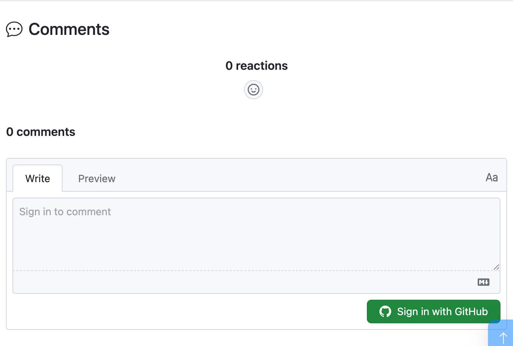
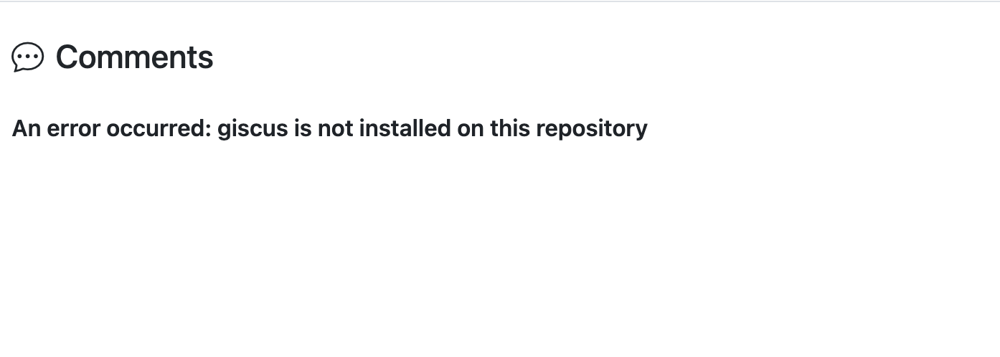

# Giscus Comments

> Add a GitHub Discussions-powered comment system to your Jekyll site with automatic theme detection and privacy-friendly design.

## Overview

[Giscus](https://giscus.app/) is a comments system powered by GitHub Discussions. Unlike traditional services like Disqus, Giscus:

- **Requires no database** — comments are stored in GitHub Discussions
- **Respects privacy** — no tracking, no ads
- **Supports reactions** — GitHub emoji reactions on comments
- **Configurable theme** — follows the visitor's light/dark preference by default, or a fixed theme you set
- **Free and open source** — MIT licensed

## Prerequisites

Before setting up Giscus, ensure you have:

1. A **public GitHub repository** for your Jekyll site
2. **GitHub Discussions enabled** on the repository
3. The **Giscus app** installed on your repository

## Installation

### Step 1: Enable GitHub Discussions

1. Go to your repository on GitHub
2. Navigate to **Settings** → **General**
3. Scroll to **Features** section
4. Check **Discussions**

### Step 2: Install Giscus App

**This is the step most likely to be silently skipped** — nothing in your repository can declare it, and no test or build can detect that it's missing. Without it the widget renders an error instead of a comment box, no matter how correct `_config.yml` is.

1. Visit [https://github.com/apps/giscus](https://github.com/apps/giscus)
2. Click **Install** (or **Configure**, if you've installed it on another account before)
3. Select the account that owns the repository
4. Grant access — either **All repositories** or **Only select repositories** including this one
5. Verify it took effect:

   ```bash
   ./scripts/bin/giscus-discussions doctor
   ```

> **Forking this theme?** A fork does **not** inherit the upstream repo's app
> installation, and the `data-repo-id` / `data-category-id` in `_config.yml` still point at `bamr87/zer0-mistakes`. You must install the app on your own repo *and* regenerate both IDs.

### Step 3: Get Configuration Values

1. Visit [https://giscus.app/](https://giscus.app/)
2. Enter your repository name (e.g., `username/repo-name`)
3. Select your preferred settings:
   - **Page ↔ Discussions Mapping**: `pathname` (recommended)
   - **Discussion Category**: Choose or create a category like "Comments"
   - **Features**: Enable reactions, lazy loading as desired
4. Copy the `data-repo-id` and `data-category-id` values

### Step 4: Configure Jekyll

Add the Giscus configuration to your `_config.yml`. Three keys are required — `enabled`, `data-repo-id`, and `data-category-id`:

```yaml
# Giscus Comment System Configuration
giscus:
  enabled: true
  data-repo-id: "YOUR_REPO_ID"
  data-category-id: "YOUR_CATEGORY_ID"
```

The `data-repo` value is filled in automatically from `site.repository` (set near the top of `_config.yml`), so you don't repeat the owner/repo here. Four more keys — the widget's theme, mapping, input position and language — are optional; see [Configuration Options](#configuration-options).

---

## Verify it works

Every layout that shows comments renders them through one include, `_includes/content/comments.html`: the `article`, `note`, `notebook`, `recipe`, and `book-story` layouts. It renders nothing unless `site.giscus.enabled` is true, and then follows the page's `comments` front matter:

| Layouts | Comments shown | Change it per page |
|---------|----------------|--------------------|
| `article`, `note`, `notebook` | By default | `comments: false` hides them |
| `recipe`, `book-story` | Only when the page opts in | `comments: true` shows them |

So blog posts (`pages/_posts/`, the `article` layout) and notes/notebooks show comments by default; docs and general pages do not, because their layouts have no comment section.

1. Build the site with the dev config:

   ```bash
   docker-compose exec -T jekyll bundle exec jekyll build \
     --config '_config.yml,_config_dev.yml'
   ```

2. Confirm the Giscus script is emitted on a built post and your IDs were
   interpolated (no empty attributes):

   ```bash
   grep -A1 'giscus.app/client.js' _site/**/index.html | grep -m1 data-repo-id
   ```

   Expected: a `data-repo-id="..."` attribute carrying your real ID. An empty `data-repo-id=""` means the `giscus` block is missing or the key is misspelled.

3. Serve the site (`docker-compose up`) and open a post. **The widget does load on
`localhost`** — Giscus keys off the `data-repo` attribute, not the page's origin, so the iframe renders and reports real errors locally. This makes localhost a genuine end-to-end check, not just a "is the tag there?" check.

   What you should see, and what each state means:

   A working widget looks like this — reaction bar, comment count, a Write/Preview box and a **Sign in with GitHub** button:

   

   | What renders under the "Comments" heading | Meaning |
   |---|---|
   | The comment box and any existing thread (above) | Fully working |
   | `An error occurred: giscus is not installed on this repository` | The [giscus app](https://github.com/apps/giscus) is not installed — see [Troubleshooting](#the-giscus-app-is-not-installed) |
   | `An error occurred: Discussion not found` | Normal for a page nobody has commented on yet; Giscus creates the discussion on the first comment |
   | Nothing at all | `enabled: false`, `comments: false` on the page (or no `comments: true` on a recipe or book-story page), or the include isn't reached |

   You will not be able to *sign in and post* from `localhost` (GitHub's OAuth redirect is bound to the deployed origin), but everything up to that point is faithful.

4. Confirm the full chain — repo public, Discussions on, **app installed**, category valid —
   with one request, no browser needed:

   ```bash
   # Replace the repo and category with your own
   curl -s -G https://giscus.app/api/discussions \
     --data-urlencode "repo=bamr87/zer0-mistakes" \
     --data-urlencode "category=Announcements" \
     --data-urlencode "term=/" \
     -d "number=0&strict=true&first=1" | head -c 200
   ```

   A JSON payload with a `discussion` key means the chain is healthy. `{"error":"giscus is not installed on this repository"}` means the app is missing — the config can be perfect and comments will still be broken.

---

## Configuration Options

### Data attributes

The theme's include lives at `_includes/content/giscus.html`. Seven of its attributes come from your `_config.yml`; three are fixed in the include.

| Attribute | Config key | Default |
|-----------|------------|---------|
| `data-repo` | `repository` (top level) | — (required) |
| `data-repo-id` | `giscus.data-repo-id` | — (required) |
| `data-category-id` | `giscus.data-category-id` | — (required) |
| `data-theme` | `giscus.data-theme` | `preferred_color_scheme` |
| `data-mapping` | `giscus.data-mapping` | `pathname` |
| `data-input-position` | `giscus.data-input-position` | `top` |
| `data-lang` | `giscus.data-lang` | `en` |
| `data-strict` | Fixed in include | `1` |
| `data-reactions-enabled` | Fixed in include | `1` |
| `data-emit-metadata` | Fixed in include | `0` |

The four optional keys sit in the same `giscus:` block:

```yaml
giscus:
  enabled: true
  data-repo-id: "YOUR_REPO_ID"
  data-category-id: "YOUR_CATEGORY_ID"
  # Optional: each falls back to the default in the table above
  data-theme: "transparent_dark"
  data-mapping: "pathname"
  data-input-position: "top"
  data-lang: "en"
```

An unset or blank key keeps its default, so a site that sets none of them renders exactly the widget it rendered before these keys existed. The values go to giscus as written (HTML-escaped), so use giscus's own values; the configurator at [giscus.app](https://giscus.app/) lists them all.

- **`data-mapping`** — how a page finds its discussion: `pathname`, `url`, `title`, or `og:title`. giscus's `specific` and `number` mappings also need a `data-term`, which the theme does not emit, so they are not supported. Changing the mapping on a site that already has comments points every page at a new discussion title, so existing threads stop showing on their pages (the discussions themselves are not touched).
- **`data-input-position`** — the comment box above (`top`) or below (`bottom`) the thread.
- **`data-lang`** — the widget's language, one site-wide value from the languages giscus ships (for example `fr`, `de`, `ja`, `zh-CN`). It does not follow a page's `lang` or `site.locale`, so on a multilingual site every language shows the widget in this one language.

### Theme options

The default, `preferred_color_scheme`, follows the visitor's operating system, not your site. On a site with a dark skin, a visitor whose OS is in light mode gets a light widget on a dark page. Set `giscus.data-theme` to a fixed theme to match the site:

| Value | Description |
|-------|-------------|
| `preferred_color_scheme` | Follows the visitor's OS light/dark setting (default) |
| `light` | Always light mode |
| `dark` | Always dark mode |
| `dark_dimmed` | Dimmed dark mode |
| `transparent_dark` | Transparent dark background — blends into a dark skin |
| Custom URL | A CSS theme of your own, e.g. `https://yoursite.com/giscus-custom.css` |

giscus has more built-in themes (high-contrast and colour-blind variants among them); the configurator at [giscus.app](https://giscus.app/) previews every one. A fixed value stays the same when a visitor switches the site between light and dark mode. A custom URL loads that stylesheet into the widget, so only point it at CSS you trust.

### Turning comments off or on per page

In the `article`, `note`, and `notebook` layouts comments are on by default. To disable them on a page, add to its front matter:

```yaml
---
title: "Page Without Comments"
comments: false
---
```

In the `recipe` and `book-story` layouts comments are off by default; `comments: true` turns them on for that page.

### Comments in your own layout

A layout of your own shows the theme's comment section — the same gate, heading, and widget — with one line:

```liquid

```

It takes three optional parameters:

| Parameter | Default | Effect |
|-----------|---------|--------|
| `default_on` | `true` | `true`: shown unless the page sets `comments: false`. `false`: shown only when the page sets `comments: true` |
| `class` | `post-comments` | The section's own class; the spacing classes are always added |
| `compact` | `false` | A `<div>` with an `<h5>` heading and no `id`, the style the note and notebook layouts use for their footer sections |

By default it renders a `<section id="comments">` with an `<h2>` heading, so links to `#comments` land on it. Like the theme's layouts, it renders nothing unless `site.giscus.enabled` is true.

---

## Building conversations with Claude Code

Because comments are GitHub Discussions, you can read, draft, and reply to them from the terminal — and Claude Code can drive the whole flow. Two pieces ship with the theme:

- **`scripts/bin/giscus-discussions`** — a `gh`-powered engine with subcommands
  `doctor`, `categories`, `list`, `thread`, `draft`, `seed`, and `post`.
- **The `giscus-conversation` skill** (`.github/skills/giscus-conversation/`) —
tells Claude Code how to read a page's thread, draft a maintainer reply with the reader's context in mind, and publish it.

```bash
# Is the whole chain healthy? (app installed, IDs match, category valid)
./scripts/bin/giscus-discussions doctor

# What categories exist (and their node IDs for _config.yml)?
./scripts/bin/giscus-discussions categories

# Which pages have comment threads?
./scripts/bin/giscus-discussions list

# Read the full conversation for a page
./scripts/bin/giscus-discussions thread --page /posts/2025/01/21/remote-work-revolution/

# Draft a reply scaffold (thread context + a REPLY section to fill in)
./scripts/bin/giscus-discussions draft --number 7 --out reply.md

# Preview, then post (writes go to public Discussions — always --dry-run first)
./scripts/bin/giscus-discussions post --number 7 --body-file reply.md --reply-to DC_xxx --dry-run
```

The script reads the repository from `gh repo view` and the category from `_config.yml`; override with `--repo` / `--category-id` (or the `GISCUS_REPO` / `GISCUS_CATEGORY_ID` env vars) when working against a fork. Writes (`seed`, `post`) are no-ops under `--dry-run`. A read-only [`giscus-digest.yml`](https://github.com/bamr87/zer0-mistakes/blob/main/.github/workflows/giscus-digest.yml) workflow surfaces new comment activity in the Actions job summary.

---

## How a page maps to a discussion

With `data-mapping="pathname"` (the default) and `data-strict="1"` (fixed in the include), Giscus finds a page's thread by matching the discussion **title** against the page's pathname — with the **leading slash removed**.

For `https://zer0-mistakes.com/posts/2025/01/21/remote-work-revolution/` the widget requests:

```text
term=posts/2025/01/21/remote-work-revolution/
```

So the discussion backing that page must be titled exactly:

```text
posts/2025/01/21/remote-work-revolution/
```

**not** `/posts/2025/01/21/remote-work-revolution/`. This matters in exactly two situations:

- **You seed a thread by hand.** A leading slash produces a discussion Giscus
  will never find — the page keeps showing an empty widget while the discussion sits in the category looking correct. `giscus-discussions seed --page /any/form/` normalizes this for you; passing `--title` yourself does not.
- **You migrate or rename discussions.** Retitle to the no-leading-slash form or
  the mapping breaks silently.

In the normal case you never think about this: Giscus creates the discussion itself, correctly titled, the first time a visitor comments.

---

## Migration from Disqus

If migrating from Disqus:

1. **Export Disqus comments** (optional — for archival)
2. **Remove Disqus scripts** from your templates
3. **Delete Disqus configuration** from `_config.yml`
4. **Follow the installation steps** above
5. **Note**: Existing Disqus comments won't transfer to Giscus

---

## Troubleshooting

### The giscus app is not installed

The single most common way a *correctly configured* site still shows no comments. Every value in `_config.yml` can be right — repo public, Discussions on, valid IDs — and the widget will still render only this:



The [giscus.app](https://giscus.app/) configurator reports the same thing when you type the repository in — it checks all three prerequisites at once:


**Why it happens:** installing the app is a one-time action on the *repository*, not something any file in the repo can declare. Nothing in `_config.yml`, no test, and no Jekyll build can perform or detect it — so it is easy to complete every documented "configuration" step and still be missing the prerequisite. Forks are especially exposed: a fork inherits the config but **not** the upstream repo's app installation.

**Fix:** install the app at [github.com/apps/giscus](https://github.com/apps/giscus) → **Configure** → select the account → grant access to the repository (either "All repositories" or "Only select repositories" including this one).

**Verify** without opening a browser — this is the check worth putting in your setup notes:

```bash
curl -s -G https://giscus.app/api/discussions \
  --data-urlencode "repo=OWNER/REPO" \
  --data-urlencode "category=Announcements" \
  --data-urlencode "term=/" \
  -d "number=0&strict=true&first=1" | head -c 200
```

`{"error":"giscus is not installed on this repository"}` → still missing. Any JSON with a `discussion` key → installed and working.

### Comments Not Appearing

1. **Check repository visibility** — must be public
2. **Verify Discussions are enabled** on the repository
3. **Confirm Giscus app is installed** on the repository
4. **Validate configuration IDs** match your repository — `data-repo-id` must
belong to **this** repo (a forked-in ID from the upstream repo will make the widget show a "repository does not match" error even though the script tag renders). Regenerate at [giscus.app](https://giscus.app/), or list valid category IDs with `./scripts/bin/giscus-discussions categories`.
5. **Check the config key spelling** — it must be `giscus:` (not `gisgus:`);
the comment section (`_includes/content/comments.html`) reads `site.giscus.enabled`. The `Giscus Comments Configuration` core test guards this.

### Theme Not Matching

By default the widget uses `data-theme="preferred_color_scheme"`, which follows the visitor's OS light/dark preference rather than your site, so a dark-skin site shows a light widget to every visitor whose OS is in light mode. Set a fixed theme in `_config.yml` (see [Theme options](#theme-options)):

```yaml
giscus:
  # ...enabled, data-repo-id, data-category-id...
  data-theme: "transparent_dark"   # or "light", "dark", "dark_dimmed", ...
  # or load a custom CSS theme:
  # data-theme: "https://yoursite.com/giscus-custom.css"
```

### Multiple Comment Threads

If pages are creating duplicate discussions:

1. The include always sets `data-strict="1"`, and `data-mapping` defaults to `pathname` — check that `giscus.data-mapping` in `_config.yml` is unset or the mapping you intend, and that your site does not override `_includes/content/giscus.html`
2. Verify page URLs are stable (no trailing-slash issues), since `pathname` mapping keys discussions to the URL path

---

## Best Practices

1. **Pathname mapping and strict mode are on by default** — `data-mapping` defaults to `pathname` and the include always sets `data-strict="1"`, which is the most reliable setup for Jekyll sites
2. **Create a dedicated category** — keeps comments organized
3. **Test locally** — the embedded thread won't load on localhost, but verify the `https://giscus.app/client.js` script tag is present
4. **Disable per page when needed** — set `comments: false` in a page's front matter (in the `article`, `note`, and `notebook` layouts; `recipe` and `book-story` pages opt in with `comments: true`)
5. **Match the widget to your skin** — on a dark-skin site, set `giscus.data-theme` (for example `transparent_dark`) so light-mode visitors don't get a light widget on a dark page

---

## Further Reading

- [Giscus Documentation](https://giscus.app/)
- [GitHub Discussions Guide](https://docs.github.com/en/discussions)
- [Giscus GitHub Repository](https://github.com/giscus/giscus)

---

*This guide is part of the [Zer0-Mistakes Jekyll Theme](https://github.com/bamr87/zer0-mistakes) documentation.*

## See also

- [[Features]]
- [[PostHog Analytics]]
