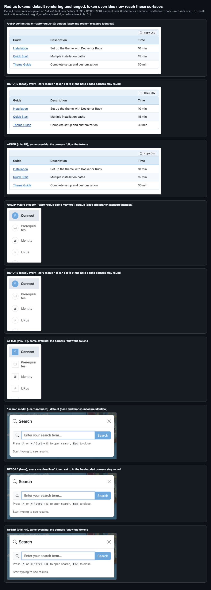

# Evidence — radius tokens across the Sass partials

Proof for #390 (backlog T-035): about sixty `border-radius` literals in `_sass/` now read the `--zer0-radius-*` tokens they already equalled. The default rendering does not change; a site that overrides a token now re-rounds every component on the scale, not just the few that used the tokens before.

## The change

| Literal | Token |
| --- | --- |
| `0.25rem` / `.25rem` | `var(--zer0-radius-sm)` |
| `0.375rem` / `.375rem` | `var(--zer0-radius)` |
| `0.5rem` / `.5rem` | `var(--zer0-radius-lg)` |
| `0.75rem` | `var(--zer0-radius-xl)` |
| `50%` | `var(--zer0-radius-circle)` |

Off-scale radii (a 2px underline, the 10px cards, the book and cookbook spines, the 1rem feedback sheet) keep their literal with an `// off-scale: <why>` comment. The setup wizard's cards read `--zer0-radius-md`, which no token file declares, so they always rendered the `0.5rem` fallback; they now read `--zer0-radius-lg`, the same 0.5rem. The duplicate `max-width: 768px` hero rules in `_ui-enhancements.scss` (2rem title, 1rem lead) were dead, because the later block set 1.75rem and 0.95rem with the same selectors, so they are removed.

## Default rendering is identical (`metrics.json`)

`radius-tokens-evidence.mjs` loaded `/`, `/docs/`, `/features/` and `/setup/` at 390px and 1280px on a build of `main` and a build of this branch, read the four computed corner radii of every element and painted `::before`/`::after`, and compared them element by element: 9,304 element radii, 0 differences (`totals`).

It also compared the two compiled `main.css` files with every radius token resolved the way the browser resolves it (a declared token to its value, the undeclared `-md` to its fallback). The only lines left on either side are the dead hero rules: `.bg-primary .display-4 { font-size: 2rem }` and `.bg-primary .lead { font-size: 1rem }` (`compiledCss.onlyBefore`), with nothing new on the branch (`compiledCss.onlyAfter` is empty).

## Overrides now reach these components (`01-token-override.png`)

`tokenConsumers` counts the elements whose corners take a sentinel value set on one token (`--zer0-radius: 13px`, …). On `/docs/` at 1280px, `--zer0-radius` reached 0 elements on `main` and 13 on this branch, and `--zer0-radius-lg` 0 and 23. On `/setup/`, `--zer0-radius-circle` reached 0 and 22 (the wizard's step markers).



Each component appears three times: its default, then `main` and this branch with every radius token set to 0. On `main` the content table, the wizard's step markers and the search modal stay round, because their corners were literals the override never reached. On this branch they follow the tokens and go square.

## Regenerate

```bash
# two builds, both with --config _config.yml,_config_dev.yml, served on two ports
BASE_URL=http://localhost:4000 BEFORE_URL=http://localhost:4001 \
  node test/visual/radius-tokens-evidence.mjs
```

The regression spec is `test/visual/features/radius-tokens.spec.js`; the static guard is `scripts/design-system-check.rb`, whose new audits `test/test_core_checks.sh` proves can fail.
